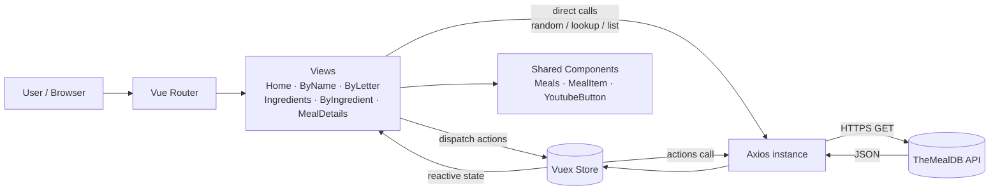

# 🍽️ Search Meals with Vue.js

A fast, responsive single-page web app for discovering recipes. Search meals by **name**, browse them by **first letter (A–Z)**, explore them by **ingredient**, or just enjoy a feed of **random trending meals** on the home page. Every meal has a detailed page with its image, category, cuisine, ingredients, measurements, cooking instructions, and a link to a YouTube tutorial.

All data comes from the free [TheMealDB API](https://www.themealdb.com/api.php), so the project is **frontend-only** — there is no backend or database to set up.


---

## 📑 Table of Contents

- [Features](#-features)
- [Tech Stack](#-tech-stack)
- [Architecture Overview](#-architecture-overview)
- [Application Routes](#-application-routes)
- [API Endpoints Used](#-api-endpoints-used)
- [State Management (Vuex)](#-state-management-vuex)
- [Project Structure](#-project-structure)
- [Getting Started](#-getting-started)
- [Deployment Notes](#-deployment-notes)
- [Known Limitations & Roadmap](#-known-limitations--roadmap)
- [Contributing](#-contributing)
- [License](#-license)
- [Acknowledgments](#-acknowledgments)

---

## ✨ Features

| Feature | Description |
| --- | --- |
| 🔥 **Top Trending Meals** | The home page loads **10 random meals** on every visit, displayed as a card grid. |
| 🔎 **Search by Name** | Type a meal name (e.g. *"Arrabiata"*) and get matching recipes. |
| 🔤 **Browse by Letter** | A clickable **A–Z** index lists every meal whose name starts with the chosen letter. |
| 🥕 **Browse by Ingredient** | View the full ingredient list, filter it with a live search box, and click an ingredient to see every meal that uses it. |
| 📖 **Meal Details** | Image, category, area (cuisine), tags, full instructions, up to 20 ingredients with matching measures. |
| ▶️ **YouTube & Source Links** | Each meal links to its video tutorial and to the original recipe source. |
| 📱 **Responsive UI** | Built with Tailwind CSS utility classes; the grid adapts from 1 column (mobile) to 3 columns (desktop). |
| ⚡ **Fast Navigation** | Client-side routing with Vue Router (no full page reloads). |

---

## 🛠 Tech Stack

| Layer | Technology |
| --- | --- |
| **Framework** | [Vue 3](https://vuejs.org/) (v3.4.x) using the Composition API (`<script setup>`) |
| **Build Tool** | [Vite](https://vitejs.dev/) |
| **Routing** | [Vue Router 4](https://router.vuejs.org/) (v4.4.x, HTML5 history mode) |
| **State Management** | [Vuex 4](https://vuex.vuejs.org/) (v4.1.x) |
| **HTTP Client** | [Axios](https://axios-http.com/) |
| **Styling** | [Tailwind CSS](https://tailwindcss.com/) |
| **Data Source** | [TheMealDB](https://www.themealdb.com/api.php) public JSON API |

> ℹ️ **This is not a MERN project.** It does not use MongoDB, Express, or Node.js on the server. It is a pure **Vue.js** frontend that talks directly to a third-party REST API.

---

## 🏗 Architecture Overview



**How it works**

1. A single **Axios instance** is created with `baseURL` set to `https://www.themealdb.com/api/json/v1/1/`.
2. **Views** (pages) either call the API directly (Home, Ingredients list, Meal Details) or **dispatch Vuex actions** (search by name, by letter, by ingredient).
3. Vuex **mutations** store the results in state; views read them reactively.
4. A reusable **`Meals`** component renders a grid of **`MealItem`** cards, and **`YoutubeButton`** renders the orange YouTube link.
5. A small global filter, `truncateWords`, shortens instructions to the first **20 words** on meal cards.

---

## 🧭 Application Routes

| Path | Route Name | View | Purpose |
| --- | --- | --- | --- |
| `/` | `home` | Home | 10 random "Top Trending" meals |
| `/by-name/:name?` | `byName` | MealsByName | Search meals by name |
| `/by-letter/:letter?` | `byLetter` | MealsByLetter | A–Z browsing |
| `/ingredients` | `ingredients` | Ingredients | Searchable ingredient list |
| `/by-ingredient/:ingredient` | `byIngredient` | MealsByIngredient | Meals that use the selected ingredient |
| `/meal/:id` | `mealDetails` | MealDetails | Full recipe page |
| `/guest` | – | Guest (placeholder) | Placeholder "Login Page" – not yet implemented |

All routes except `/guest` are rendered inside a **`DefaultLayout`** that contains the navigation bar and the main content area.

---

## 🌐 API Endpoints Used

Base URL: `https://www.themealdb.com/api/json/v1/1/`

| Endpoint | Used For |
| --- | --- |
| `random.php` | Home page — called 10 times to get 10 random meals |
| `search.php?s={name}` | Search meals by name |
| `search.php?f={letter}` | List meals by first letter |
| `filter.php?i={ingredient}` | Filter meals by main ingredient |
| `list.php?i=list` | Fetch the full list of ingredients |
| `lookup.php?i={id}` | Fetch full details of a single meal |

> 🔑 The project uses TheMealDB's free **test API key (`1`)**, which is already part of the base URL. **No `.env` file or personal API key is required** to run the project.

---

## 🧠 State Management (Vuex)

The store holds the results of the three list-style searches and the currently selected ingredient.

**State**

```js
{
  searchedMeals: [],       // results of search by name
  mealsByLetter: [],       // results of search by first letter
  mealsByIngredient: [],   // results of filter by ingredient
  ingredient: {}           // the ingredient the user clicked on
}
```

**Actions** (async – call the API, then commit)

| Action | API Call | Commits |
| --- | --- | --- |
| `searchMeals(name)` | `search.php?s=` | `setSearchedMeals` |
| `searchMealsByLetter(letter)` | `search.php?f=` | `setMealsByLetter` |
| `searchMealsByIngredient(ingredient)` | `filter.php?i=` | `setMealsByIngredients` |

**Mutations** (sync – update state; fall back to `[]` when the API returns `null`)

`setSearchedMeals` · `setMealsByLetter` · `setMealsByIngredients` · `setIngredient`

---

## 📁 Project Structure

> ⚠️ **Important:** this repository currently contains the **production build output** of the app (the `dist/` folder contents), not the original source files. The structure below describes what is in the repo **today**, followed by the source layout the build was generated from.

### What is in the repository now

```
Search-Meals-with-VueJS/
├── assets/
│   ├── index-DBHWI7M0.js     # Bundled & minified JavaScript (Vue, Router, Vuex, Axios, app code)
│   └── index-CB8K8fJ3.css    # Compiled & purged Tailwind CSS
├── index.html                # App entry point (mounts Vue on #app)
├── vite.svg                  # Favicon
└── README.md
```

### Source layout the build was generated from (reconstructed)

```
src/
├── main.js                   # Creates app, installs router + store, mounts #app, registers $filters.truncateWords
├── App.vue                   # Root component – renders <router-view />
├── router/                   # Route table (history mode)
├── store/                    # Vuex store: state, actions, mutations
├── axiosClient.js            # Axios instance with TheMealDB baseURL
├── components/
│   ├── Navbar.vue            # Top navigation
│   ├── Meals.vue             # Responsive grid of meal cards (+ empty state)
│   ├── MealItem.vue          # Single meal card (image, name, 20-word summary, YouTube link)
│   └── YoutubeButton.vue     # Reusable orange YouTube button
├── views/
│   ├── Home.vue              # "Top Trending Meals" (10 random meals)
│   ├── MealsByName.vue       # Search by name
│   ├── MealsByLetter.vue     # A–Z browsing
│   ├── Ingredients.vue       # Ingredient list + live filter
│   ├── MealsByIngredient.vue # Meals for a chosen ingredient
│   └── MealDetails.vue       # Full recipe page
└── layouts/
    └── DefaultLayout.vue     # Navbar + <main> wrapper for all pages
```

---

## 🚀 Getting Started

### Prerequisites

- [Node.js](https://nodejs.org/) **v18 or later**
- npm (bundled with Node.js)
- A modern web browser

### Option 1 — Run the existing build (works with this repo as-is)

```bash
# 1. Clone the repository
git clone https://github.com/Ayush-verma25/Search-Meals-with-VueJS.git
cd Search-Meals-with-VueJS

# 2. Serve the folder as a single-page app
npx serve -s .
```

Open the URL printed in the terminal (usually `http://localhost:3000`).

> The `-s` flag enables **SPA fallback**, which is required so that deep links such as `/meal/52772` or `/by-letter/B` don't return a 404 when you refresh the page.

### Option 2 — Develop from source

Once the original source code (`src/`, `package.json`, `vite.config.js`, Tailwind config) is pushed to the repository, the standard workflow will be:

```bash
npm install          # install dependencies
npm run dev          # start the Vite dev server with hot reload
npm run build        # create an optimized production build in dist/
npm run preview      # preview the production build locally
```

### Environment Variables

None. The API key is the public test key `1`, embedded in the Axios base URL.

---

## ☁️ Deployment Notes

Because the app uses **HTML5 history mode** (clean URLs without `#`), the hosting platform must redirect all unknown paths to `index.html`.

| Platform | How to enable SPA fallback |
| --- | --- |
| **Netlify** | Add `/*  /index.html  200` to a `_redirects` file |
| **Vercel** | Add a `vercel.json` rewrite: `{ "rewrites": [{ "source": "/(.*)", "destination": "/index.html" }] }` |
| **GitHub Pages** | Copy `index.html` to `404.html`, and set Vite's `base` option to your repo name |
| **Nginx** | `try_files $uri /index.html;` |

> The built `index.html` references assets with **absolute paths** (`/assets/...`), so the app should be served from the domain root, or Vite's `base` option should be configured before building for a sub-path deployment.

---

## 🧩 Known Limitations & Roadmap

These points come from analyzing the current build and are great first issues for contributors:

- [ ] **Push the source code** (`src/`, `package.json`, configs) so others can run, modify, and contribute.
- [ ] **Favorites** – save meals to a favorites list (e.g. persisted in `localStorage`).
- [ ] **Category filter** – TheMealDB offers `categories.php` and `filter.php?c=`; not yet wired up.
- [ ] **Loading & error states** – show spinners and friendly messages when API calls are slow or fail.
- [ ] **Search by area/cuisine** via `filter.php?a=`.
- [ ] **Login / guest area** – the `/guest` route is only a placeholder.
- [ ] Replace the default page title **"Vite + Vue"** with a proper app title and favicon.
- [ ] Fix the heading typo **"Top Tranding Meals" → "Top Trending Meals"**.
- [ ] Debounce the search input to reduce API requests.
- [ ] Add unit tests (Vitest) and a GitHub Actions workflow for build/lint.
- [ ] Consider migrating from **Vuex** to **Pinia**, the officially recommended store for Vue 3.

---

## 🤝 Contributing

Contributions, issues, and feature requests are welcome!

1. **Fork** the repository
2. **Create** a feature branch: `git checkout -b feature/AmazingFeature`
3. **Commit** your changes: `git commit -m "Add some AmazingFeature"`
4. **Push** to the branch: `git push origin feature/AmazingFeature`
5. **Open** a Pull Request

---

## 📄 License

Distributed under the **MIT License**. See the `LICENSE` file for more information.

---

## 🙏 Acknowledgments

- [TheMealDB](https://www.themealdb.com/) for the free recipe API
- [Vue.js](https://vuejs.org/), [Vite](https://vitejs.dev/), and [Tailwind CSS](https://tailwindcss.com/) communities

---

<p align="center">Made with ❤️ by <a href="https://github.com/Ayush-verma25">Ayush Verma</a></p>
